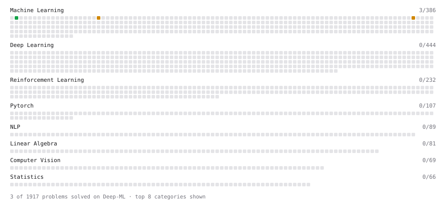

# Deep-ML

My machine learning practice from [Deep-ML](https://www.deep-ml.com). Every solution here was written by hand.

**6** solved · 3 problems · 0 labs · 3 math

[**Browse the interactive portfolio**](https://kuzma310.github.io/deep-ml/) to replay this filling in over time.

## Problems

| | Difficulty | Solved | |
| --- | --- | --- | --- |
| [Linear Regression Using Gradient Descent](https://www.deep-ml.com/problems/15) | easy | 2026-11-04 | [solution](problems/0015-linear-regression-using-gradient-descent) |
| [Implement Gradient Descent Variants with MSE Loss](https://www.deep-ml.com/problems/47) | medium | 2026-11-04 | [solution](problems/0047-implement-gradient-descent-variants-with-mse-loss) |
| [Numerical Gradient Checking](https://www.deep-ml.com/problems/313) | medium | 2026-11-05 | [solution](problems/0313-numerical-gradient-checking) |

## Math

| | Difficulty | Solved | |
| --- | --- | --- | --- |
| [Derivatives and Gradients](https://www.deep-ml.com/math-problems/1) | easy | 2026-11-04 | [solution](math/0001-derivatives-and-gradients) |
| [Gradient Descent Updates](https://www.deep-ml.com/math-problems/5) | easy | 2026-11-04 | [solution](math/0005-gradient-descent-updates) |
| [Bayesian Linear Regression: Posterior and Posterior Predictive](https://www.deep-ml.com/math-problems/454) | medium | 2026-11-05 | [solution](math/0454-bayesian-linear-regression-posterior-and-posterior-predictive) |

---

_This file is regenerated by Deep-ML on every push._
